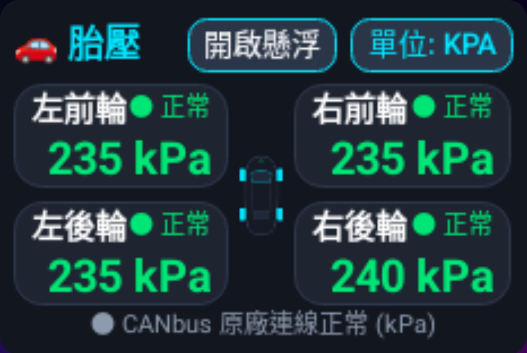
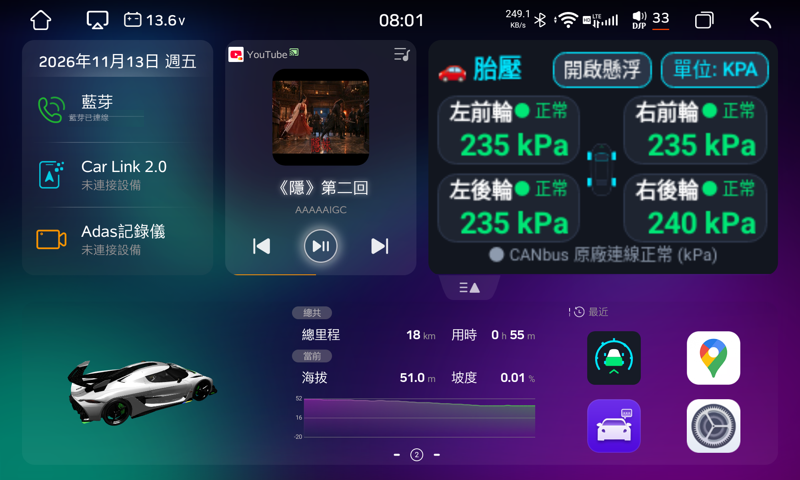
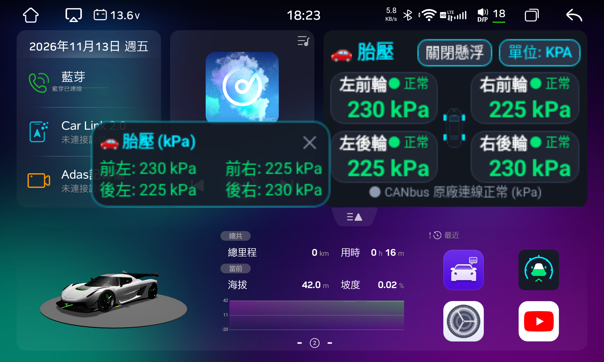
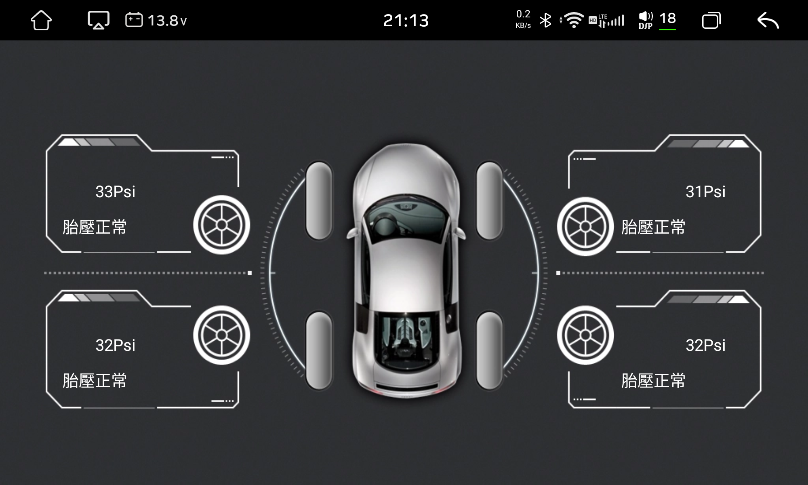

# 🚗 CleanYourCar

> **Automotive Custom Launcher Widgets & CANbus Bridge for Android Head Units (FYT 7870 / UIS7870 / 6318)**  
> 專為方易通 UIS7870 (FYT 6318) Android 13 車機打造的原廠 CANbus 胎壓桌面嵌入式小卡片與全域 HUD 懸浮視窗。

[-blue.svg)](#)
[](#)
[](#)
[](#)
[](LICENSE)

---

## 📖 專案緣起 (Overview)

許多市售 Android 車載主機（特別是 **方易通 FYT / UNISOC UIS7870 / 6318** 平台）出廠自帶的桌面啟動器（Car Launcher）往往預留了固定的側邊小卡片（如 Google Maps 嵌入槽位）。若車主希望將此槽位替換為更實用的**四輪即時胎壓 (TPMS)**，常面臨以下痛點：

1. **原廠胎壓資訊深藏於子選單**：每次開車皆需手動開啟專屬「車輛設置 / 胎壓」App，無法於主頁一眼掌握。
2. **單位限制與顯示缺失**：原廠協議常預設以 `Psi` 顯示，且未提供自訂小卡片掛載功能。
3. **無懸浮 HUD 模式**：切換至全螢幕導航（Google Maps / 導航王）或播放媒體（YouTube / CarLink）時，無法即時監看胎壓異常。

**CleanYourCar** 透過逆向分析方易通車載通訊架構，以極簡原生架構（純 Java / 原生 IPC Binder / ~50KB 體積）直接對接原廠 CANbus 協議棧，完美實現：
- **Launcher 桌面小卡片無縫嵌入**（替換地圖槽位，100% 貼合對齊）。
- **四輪獨立即時數值顯示**（精確解析 16-bit CANbus 封裝，標準 `kPa` / `Psi` / `bar` 自由切換）。
- **全域可拖曳毛玻璃 HUD 懸浮窗**（支援跨 Google Maps、YouTube、CarPlay 常駐顯示）。

---

## 🌟 實車成果展示 (Showcase)

### 1. Launcher 桌面嵌入式小卡片 (100% 貼合度)

- **四輪數值**：左前 `235 kPa`、右前 `235 kPa`、左後 `235 kPa`、右後 `240 kPa`。
- **排版優化**：雙層垂直佈局（上層「輪胎名稱 + ● 正常燈號」，下層「大字號數值」），徹底杜絕字體換行或按鈕重疊。
- **槽位掛載**：透過系統屬性 `persist.launcher.embedded_pkg com.car.tpms` 自動常駐。

### 2. 實車儀表總覽 (Full Dashboard Integration)

- 與左側多媒體播放器（YouTube）高度等比對齊，車輛上電開機自動連線 CANbus 刷新數據。

### 2. 全域 HUD 懸浮窗 (跨應用常駐膠囊)

- **跨應用拖曳**：支援在 Google Maps、YouTube、CarPlay 畫面最上層懸浮顯示。
- **單行排版**：四輪獨立顯示 `230 kPa`、`225 kPa`，字型自適應無換行截斷。
- **位置記憶**：拖曳放開後自動儲存座標，下次啟動維持原位。

### 3. 原廠協議對比 (OEM CANbus Screen)

- 逆向對標原廠 Camry / Toyota WC 協議介面，數值 100% 一致。

---

## 🛠 技術架構與逆向解析 (Architecture)

```mermaid
flowchart TD
    A["車輛 CANbus 總線 (Toyota WC 294)"] -->|0x48 原始封包| B["MCU / Syu 底層通訊庫"]
    B -->|代碼 133..136| C["com.syu.ms / ToolkitService (Module 7)"]
    C -->|onTransact (Transact 3 回調)| D["CleanYourCar (SyuCanbusManager)"]
    D -->|16-bit 解碼公式| E["即時四輪 kPa / Psi / bar 數據中心"]
    E -->|UI 雙層渲染| F["Launcher 嵌入小卡片 (MainActivity)"]
    E -->|WindowManager Overlay| G["全域 HUD 懸浮窗 (TpmsFloatService)"]
```

### 關鍵逆向突破：

1. **16-bit 打包數值還原**：
   - FYT Toyota WC 協議將胎壓高低位元組打包分發（例如分發值為 `60160` 與 `58880`）。
   - 正確解析公式為：
     ```java
     int kpa = (rawValue / 256) + (rawValue % 256);
     // 60160 -> (235 + 0) = 235 kPa
     // 58880 -> (230 + 0) = 230 kPa
     ```
2. **正確 IPC 服務綁定**：
   - 避免使用系統底層空 stub (`ServiceManager.getService("syu")`)。
   - 改採顯式 AIDL `bindService` 綁定 `com.syu.ms/app.ToolkitService`，取得 Module 7 (CANBUS) 實例。
3. **事件驅動推送 (Push vs. Poll)**：
   - 主動調用 `TRANSACTION_get` 僅能讀取 raw 快取。
   - 透過 `transact(3, update=1)` 註冊 `IModuleCallback`，開機立即推送初始數據，後續有變化即時被動回調，CPU 零負載。

---

## 🚀 快速上手 (Quick Start)

### 前置作業
- **車機端**：UIS7870 (FYT 6318) Android 13 車載主機，已開啟 ADB Wi-Fi 除錯。
- **開發端**：具備 `uv`（推薦）或 `python3`、`adb` 以及 Android SDK Command-line Tools (`aapt2`, `d8`, `zipalign`, `apksigner`)。

### 1. 取得原始碼與環境建立
```bash
git clone https://github.com/coolping/CleanYourCar.git
cd CleanYourCar

# 推薦使用 uv 快速同步虛擬環境與套件
uv sync
```

### 2. 編譯 APK (無須肥大 Android Studio)
專案內附微型編譯腳本，一鍵打包出約 50KB 之簽署安裝檔：
```bash
uv run TpmsApp/build_apk.py
# 或: python3 TpmsApp/build_apk.py
```

### 3. 一鍵部署至車機
```bash
# 自動偵測已連線的 ADB 設備
./scripts/install_tpms.sh

# 或指定車機 IP 連線部署
./scripts/install_tpms.sh 192.168.1.100:5555
```

腳本將自動執行：
1. 推送並靜默安裝 `TpmsApp.apk`。
2. 授予懸浮視窗特權 (`SYSTEM_ALERT_WINDOW`) 與通知權限 (`POST_NOTIFICATIONS`)。
3. 設定 Launcher 桌面卡片屬性 (`setprop persist.launcher.embedded_pkg com.car.tpms`)。
4. 喚醒車機介面並返回桌面即時驗證。

---

## 📊 即時診斷工具 (Diagnostic Tool)

若需在電腦終端機直接快速查看目前車機四輪胎壓狀態，可執行內附的獨立診斷腳本：

```bash
uv run scripts/read_tire_pressure.py --device 192.168.1.100:5555
# 或: python3 scripts/read_tire_pressure.py --device 192.168.1.100:5555
```

輸出範例：
```text
=============================================
        🚗 Live TPMS Diagnostic Report         
=============================================
  [Front-Left  FL] : 235 kPa    (● 正常)
  [Front-Right FR] : 235 kPa    (● 正常)
  [Rear-Left   RL] : 235 kPa    (● 正常)
  [Rear-Right  RR] : 240 kPa    (● 正常)
=============================================
            ┌─────────┐
    [FL] ───│  FRONT  │─── [FR]
   235 kPa  │         │ 235 kPa  
            │         │
    [RL] ───│  REAR   │─── [RR]
   235 kPa  └─────────┘ 240 kPa  
=============================================
```

---

## 📂 專案目錄結構 (Project Layout)

```text
CleanYourCar/
├── README.md               # 專案完整技術與使用手冊
├── LICENSE                 # MIT 授權條款
├── .gitignore              # 忽略編譯產出、金鑰與日誌
├── TpmsApp/                # Android 原始碼專案 (極簡無第三方依賴)
│   ├── AndroidManifest.xml # 清單宣告 (Overlay 權限與 Service)
│   ├── build_apk.py        # 輕量級 CLI 打包腳本
│   ├── res/
│   │   ├── drawable/       # 科技風圓角卡片與毛玻璃 HUD 造型
│   │   ├── layout/         # 車機 874x585 專屬小卡片與懸浮佈局
│   │   └── values/         # 色彩與字串定義
│   └── src/com/car/tpms/
│       ├── MainActivity.java      # 桌面嵌入小卡片核心控制器
│       ├── SyuCanbusManager.java  # CANbus AIDL IPC 協議棧與解碼器
│       └── TpmsFloatService.java  # 全域可拖曳 HUD 懸浮窗服務
├── scripts/
│   ├── install_tpms.sh     # 車機 ADB 一鍵部署腳本
│   └── read_tire_pressure.py # 終端即時診斷讀取工具
└── docs/
    ├── tpms_solution.md    # 深入逆向分析與採坑記錄
    ├── tpms_report.html    # 完整開發測試互動總結報告
    └── images/             # 實車畫面與架構圖庫
```

---

## 🤖 AI Agent 自動化提示詞 (Prompt for Agents)

若需委託其他 AI Agent 進行自動化編譯與部署，可直接複製下列標準 Prompt：

```markdown
你現在是一位專精於車載 Android 系統 (方易通 FYT 7870 / 6318) 的自動化部署 Agent。
請替我將 CleanYourCar 專案中的車載胎壓 App (TpmsApp) 完成編譯、安裝、授權並掛載至車機 Launcher 桌面。

請嚴格按照下列標準作業程序 (SOP) 執行：
1. 【環境與連線檢查】
   - 執行 `adb devices` 確認車機連線狀態（若未連線請執行 `adb connect <CAR_IP>:5555`）。
   - 確認主機環境已具備 `uv` (或 `python3`) 與 Android SDK CLI 工具 (`aapt2`, `d8`, `apksigner`, `zipalign`)。
   - 執行 `uv sync` 同步 Python 環境。
2. 【編譯打包】
   - 執行 `uv run TpmsApp/build_apk.py`，確認產出約 50KB 之 `TpmsApp/build/TpmsApp.apk`。
3. 【系統推送與配置】
   - 執行 `./scripts/install_tpms.sh <CAR_IP>:5555` 完成安裝、權限配置與 Launcher 嵌入槽位綁定。
4. 【驗證結果】
   - 模擬按下 HOME 鍵返回桌面：`adb shell input keyevent KEYCODE_HOME`。
   - 擷取畫面驗證四輪是否皆正常顯示數值（如 235 kPa）且狀態顯示為「● 正常」。
```

---

## 🛡 安全與隱私說明 (Privacy & Safety Notice)

本儲存庫為公開開源專案，已遵循最高安全與隱私標準：
- **零敏感資訊**：所有個人裝置名稱、特定私人區域 IP 位址、車輛歷史行駛軌跡與私密憑證均已全面脫敏或參數化。
- **純本地無連網**：TpmsApp 完全不具備網際網路權限 (`android.permission.INTERNET`)，所有 CANbus 通訊均於車機本地 IPC 傳輸，絕無資料外洩風險。

---

## 📄 授權條款 (License)

本專案採用 [MIT License](LICENSE) 授權，歡迎自由修改、客製或整合至您的車載系統中。
