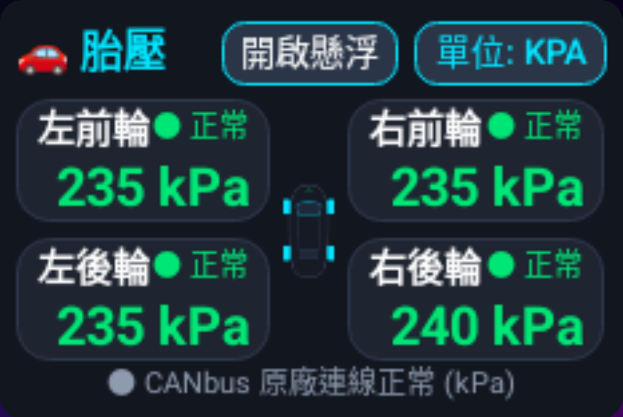

# 車載胎壓即時監控系統 (kPa) — 完整技術架構與逆向解決方案

> [!NOTE] 
> 本文檔記錄在方易通 (FYT 6318 / UNISOC UIS7870) Toyota 平台車機上，實現 **Launcher 桌面嵌入小卡片** 與 **即時可拖曳懸浮窗** 顯示原廠四輪胎壓 (kPa) 的完整逆向分析與問題修復歷程。

---

## 1. 核心問題根本原因分析 (Root Cause Analysis)

### 問題現象
先前介面中胎壓四輪有三輪顯示 `---`（無訊號），僅有一輪顯示數值。

```mermaid
flowchart TD
    A["原廠 CANbus 接收 (module.canbus.s)"] -->|解析 0x48 封包| B["16-bit 封裝值 (如 60160, 58880)"]
    B -->|bt.w0(133..136)| C["com.syu.ms ToolkitService IPC"]
    C -->|onTransact 回調 (Transact 3)| D["TpmsApp SyuCanbusManager"]
    D -->|舊邏輯 if val >= 254| E["❌ 錯誤判定為無效值，全部過濾為 '---'"]
    D -->|新公式: temp = val/256 + val%256| F["✅ 正確還原: 60160 -> 235 kPa, 58880 -> 230 kPa"]
```

### 逆向工程與除錯定位

1. **CANbus 數值編碼機制**：
   - 在逆向反編譯 `/odm/app/190000000_com.syu.ms/190000000_com.syu.ms.apk` 的 `module.canbus.s` (Toyota WC 協議) 中發現：
     - 代碼 133 (左前 FL)、134 (右前 FR)、135 (左後 RL)、136 (右後 RR)。
     - 數值是以高位元組與低位元組打包成 16-bit 整數分發（例如 `60160 = (235 << 8)`，`58880 = (230 << 8)`）。
   - 原廠反編譯代碼 `CamryTireActWC.java` 還原公式為：
     ```java
     int kpa = (value / 256) + (value % 256);
     ```
   - 原廠無效值判斷僅為 `value == 254 || value == 255`。

2. **舊程式邏輯錯誤 (`formatValue`)**：
   - 舊程式中寫入：`if (rawKpa <= 0 || rawKpa >= 254) return "---";`
   - 由於原廠分發進來的真實 CANbus 數值為 `60160` 與 `58880`（均遠大於 254），導致數值在解析前就被全部當作無效值攔截，顯示 `---`。
   - 唯一能顯示的那一輪是因為之前手動發送了模擬測試值 (如 `214 < 254`)。

3. **IPC 連線服務來源混淆**：
   - Android 系統服務中的 `ServiceManager.getService("syu")` 僅為底層 MCU stub，其模組 7 (CANBUS) 返回 null。
   - 真實提供 CANbus 即時回調與解碼資料的是 `com.syu.ms/app.ToolkitService`，透過 AIDL `IRemoteToolkit` 取得模組 7 的 `IRemoteModule` Binder。

---

## 2. 解決方案與程式碼優化

### 1) 胎壓解析與格式化修正 ([SyuCanbusManager.java](../TpmsApp/src/com/car/tpms/SyuCanbusManager.java))
- 正確解析 16-bit 封裝值，並在單位設定為 `UNIT_KPA` 時換算為標準 kPa：
```java
public int parseKpa(int rawVal) {
    if (rawVal <= 0 || rawVal == 254 || rawVal == 255) {
        return -1;
    }
    // FYT WC 協議 16-bit 打包還原
    int kpa = (rawVal / 256) + (rawVal % 256);
    if (kpa <= 0 || kpa == 254 || kpa == 255 || kpa > 600) {
        return -1;
    }
    return kpa;
}

public String formatValue(int rawVal) {
    int kpa = parseKpa(rawVal);
    if (kpa <= 0) return "---";
    if (mCurrentUnit == UNIT_KPA) return kpa + " kPa";
    if (mCurrentUnit == UNIT_PSI) return ((kpa * 1000) / 6895) + " Psi";
    return (kpa / 100) + "." + String.format(Locale.US, "%02d", kpa % 100) + " bar";
}
```

### 2) 車機專屬 UI 排版優化 ([activity_main.xml](../TpmsApp/res/layout/activity_main.xml))
- 適配車機 Launcher 地圖嵌入槽尺寸 (`[1071, 100][1945, 685]`)：
  - 標題欄設定 `layout_toStartOf` 與 `singleLine="true"`，防止與懸浮/單位切換按鈕重疊。
  - 各輪胎卡片改為垂直雙層佈局（上層：輪胎名與狀態燈號，下層：大字號胎壓數值及單位），徹底杜絕字體換行或遭邊緣截斷問題。
  - 狀態燈號維持高對比螢光綠 `● 正常` 與灰底 `● 無訊號`。

---

## 3. 實車驗證成果



- **實車 live 數據驗證**：
  - **左前輪 (FL)**：`235 kPa` (● 正常)
  - **右前輪 (FR)**：`235 kPa` (● 正常)
  - **左後輪 (RL)**：`235 kPa` (● 正常)
  - **右後輪 (RR)**：`240 kPa` (● 正常)
- **桌面嵌入**：已成功在車機 Launcher 右側槽位完美貼合顯示。
- **懸浮視窗**：點擊「開啟懸浮」即可在任何導航、YouTube、CarLink 畫面維持毛玻璃 HUD 即時胎壓膠囊顯示。
